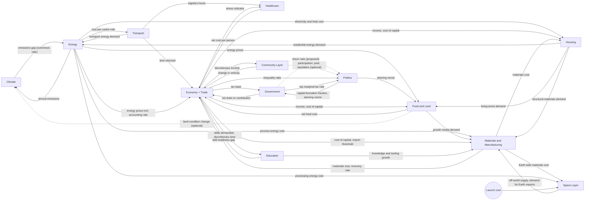

# Simulation Spec

**Dynamic Story** · links to Version Zero v0.1.0 (VZ §3, §4, §7)

## 0. Conventions

- **Method.** The core method is system dynamics: stocks, flows, and feedback loops. Discrete-event and agent models can sit inside a sector where they help (for example, fleet dispatch in transport).
- **Horizon and step.** Each run covers 20 to 50 years in annual steps.
- **Outputs are ranges.** Every output is reported as a low / middle / high scenario with a confidence band. Nothing is a single-date prediction. When observed data comes in, the parameters are re-estimated and the story updates (VZ §3).
- **Interface discipline.** Bruce wanted the sectors "somewhat independent" without "too many crisscrossing connections". So no sector shares a stock with another. Sectors exchange only the named numbers in §14, once a year.
- **Versioning.** The spec and every model are versioned the same way as Version Zero: major for structure, minor for a new sector or loop, patch for parameters.
- **Markers.** "From chat, to verify" means a number came from the conversation and has not been checked. "Proposed" means the item fills a gap the conversation left open.

Loops are labeled **R** (reinforcing) and **B** (balancing).

---

## 1. Climate

**Purpose.** Own the atmosphere's ledger: concentrations, the carbon budget, and the gap. It never sees prices, reserves, or cars.

**Inputs**
| From | Number |
|---|---|
| Energy | Annual CO2 emissions (by fuel) |
| Food and land (optional) | Land-condition change (soil and land carbon) |

**Outputs.** To energy: the **cumulative emissions gap**, which is a pair:

1. Stock overshoot: tons of CO2 already emitted beyond a path that keeps warming inside a chosen band.
2. Gap growth rate: tons per year still being added.

This is not a temperature forecast and not a policy recommendation. "Temperature is noisy and arrives late. The gap is the accounting error itself."

**Stocks.** Atmospheric CO2. Cumulative emissions since the reference year. The remaining budget for the chosen band.

**Flows.** Annual emissions in. Natural uptake out (ocean and land sinks).

**Loops**

- B1 (cross-sector): wider gap → higher accounting rate in energy → lower emissions → gap stops growing.
- B2: natural sinks absorb part of each year's emissions.
- R (proposed, not in chat): weaker sinks under warming. Leave it out of v0.1 for simplicity, and note it as a known omission.

**Story.** 3.6 The Missing Ledger Line.

Verified 2026-10-12 against Global Carbon Budget 2024: remaining budget for 50% likelihood of 1.5°C is about 235 GtCO2 from the beginning of 2025; fossil CO2 about 37.4 GtCO2 in 2024. The chat's "400 billion tons over" example was illustrative and should not be used (see §16.8).

---

## 2. Energy

**Purpose.** Reserves, clean capacity, extraction, build rates, and prices. This is the first simulation to build.

**Inputs**
| From | Number |
|---|---|
| Climate | Cumulative emissions gap (overshoot + growth rate) |
| Transport | Transport energy demand by type |
| Housing | Residential energy demand by type |
| Economy (implicit) | Cost of capital for builds. Not stated in the chat. Proposed. |

**Outputs**

- To climate: annual emissions.
- To transport: delivered cost per useful mile by fuel type.
- To economy, food and land, housing, and materials: delivered energy prices with the accounting rate already applied.

**Stocks**

- Fossil reserves, in recoverable energy (not dollars).
- Clean (renewable and nuclear) capacity, in deliverable energy per year.
- Carbon accounting rate, the current correction per ton of CO2. The chat called it both a flow and a stock. Here it is a stock, adjusted by a flow. See §16.

**Flows**

- Extraction (draws down reserves and emits).
- New clean capacity built.
- Retirement of old plants and vehicles.
- Accounting-rate adjustment. It rises when the gap is wide or still growing, and falls only when the gap is closing. The rate lands on each fuel per ton of CO2 emitted, so coal is charged more than gas, and gas more than anything near zero.

**Loops (corrected version, see §16)**

- R1 learning: more clean capacity built → lower clean cost → faster adoption → more built. Fossil demand falls.
- B1 cheap fuel: lower fossil demand → fossil price falls (supply and demand) → pull back toward burning it. The accounting rate sits on this loop so that "cheap fuel does not become free fuel". The rate does not fall with the pump price.

**Output ranges.** Extraction path and fuel left in the ground under low, middle, and high accounting paths.

**Story.** 3.1 Gold and the Lead (the leftover fuel is "the gold-and-lead problem in numbers"). 3.7 Cheap Is Not Free. 3.6 Missing Ledger Line.

---

## 3. Transport

**Purpose.** Fleet, ownership, utilization, and what motion costs and consumes.

**Inputs**
| From | Number |
|---|---|
| Energy | Delivered cost per useful mile by fuel type, after the accounting rate |

**Outputs**

- To energy: annual energy demand by type (electricity, liquid fuel, or energy equivalent).
- To economy: time returned (hours per adult per week no longer spent driving, maintaining, or parking).
- To healthcare: the logistics part of friction.

**Stocks**

- Vehicle fleet by type: personal cars, shared autonomous vehicles, trucks, transit.
- Average utilization (hours per day a vehicle is moving).
- Road and charging capacity.

**Flows.** Fleet turnover. The shift from owned to shared. Change in utilization. The resulting energy demand.

**Loops**

- R1 utilization: higher utilization → lower cost per mile → more trips go to shared autonomous vehicles → higher utilization, smaller total fleet.
- B1 congestion: too many vehicles on the same roads or plugs → speeds fall → the advantage shrinks.
- Crashes avoided (optional, not required for v0.1).

**Story.** 3.2 The Front Door. 3.3 The Idle Fleet (about 298 million registered motor vehicles, FHWA 2024; household vehicles parked about 95% of a typical day, DOE/NHTS 2022).

---

## 4. Healthcare

**Purpose.** Show that reducing friction can lower cost more than billing reform. The two effects stay visible separately.

**Inputs**
| From | Number |
|---|---|
| Transport | Logistics hours per adult per week |
| Economy | Stress indicator from job and income volatility |

Together these make up **friction**.

**Outputs.** To economy: net healthcare cost per person (total spending minus prevention and utilization offsets).

**Stocks**

- Prevalence of major chronic conditions.
- Administrative and billing overhead (share of spend).
- Effective prevention capacity (primary care access, early detection, lifestyle support that actually reaches people).

**Flows.** New diagnoses. Recovery or control. Growth in overhead. Change in prevention capacity.

**Loops**

- R1 friction spiral: higher friction → more chronic disease and worse control → higher spending → prevention crowded out → more chronic disease.
- B1 outcome competition: insurers and care organizations paid for keeping conditions controlled → prevention capacity grows → prevalence growth slows. (This is Bruce's "insurer that's best at curing a particular disease", beat 3.5.)

**Story.** 3.4 The Healthcare Bill. 3.5 One Code Base.

---

## 5. Economy (with trade)

**Purpose.** The meeting point. It turns the physical sectors into household money and time.

**Inputs**
| From | Number |
|---|---|
| Energy | Energy prices with the accounting rate applied |
| Healthcare | Net healthcare cost per person |
| Transport | Time returned (hours per week) |
| Government | Public net drain or contribution |
| Food and land | Net food cost per person |
| Materials | Materials cost and availability; recovery rate |
| Education | Skill-readiness gap |
| Community layer | Change in velocity |
| Space (via materials) | Off-world demand for Earth exports |

**Outputs**

- **Household discretionary income** after essentials, net of import leakage. Goes to the community layer, government (tax base), housing, and food and land.
- Employment mix by type and skills demanded: to government and education.
- Stress indicator: to healthcare.
- Cost of capital and the domestic-vs-import threshold: to housing and materials.

**Stocks**

- Employment by type: physical production, local services, care and coordination, and the residual being absorbed by automation.
- Capital tied up in idle private vehicles and other underused assets.
- Velocity of ordinary spending (turns per year). Strictly an auxiliary, but tracked as a state.
- Trade: foreign production capacity that currently supplies finished goods.
- The chat also listed a public balance here. It moves to government. See §16.

**Flows.** Job displacement. New local and care work. Capital released when shared fleets replace owned cars. The essentials vs everything-else split. Trade: import volume (value and displaced jobs or capital), exports, and the shift share.

**Trade threshold.** A good shifts home when domestic landed cost falls below import landed cost.

- Import landed cost = factory price abroad + freight + insurance + tariffs + domestic last mile.
- Domestic landed cost = capital recovery + energy + materials + small labor/supervision + near-zero freight.

Three things move the threshold: energy price (from energy), machine utilization, and the scale of the local run. The **shift share** is the fraction of import value whose domestic landed cost has crossed below the foreign one. It starts near zero for complex electronics and higher for bulky, simple, or energy-intensive goods.

**Loops**

- R1 friction dividend: less friction and lower logistics cost → more discretionary time and income → local services and care work grow → people automation would otherwise idle are employed.
- R2 hyper-local: cheap clean energy and automation → domestic landed cost falls → imports fall → more income circulates locally → velocity rises.
- B1 concentration: gains pool in a few firms or balance sheets → velocity falls → local demand thins → new work does not appear.
- B2 incumbent supply chains: existing foreign tooling, clustered suppliers, and paid-off machines keep imports cheaper until domestic capacity is actually built and running.

**Failure signal.** If velocity falls while cost per person stays high, the transition is failing "even if GDP looks fine".

**Story.** 4.1 The Survival Question. 4.4 Made Here Again. 3.3 The Idle Fleet.

---

## 6. Government

**Purpose.** Tax, spending, debt, and the difference between spending that builds and spending that is thrown away.

**Inputs**
| From | Number |
|---|---|
| Economy | Tax base (discretionary income and employment picture) |
| Politics | Capital-formation fraction; steering vector |

**Outputs.** To economy: **public net drain or contribution**, which is taxes minus spending on infrastructure, basic order, and debt service, per person or as a share of income. Positive means the public balance adds resources to circulation.

**Stocks**

- Public capital: roads, grids, ports, courts, research platforms, ecological restoration.
- Debt stock, and its service cost.
- Administrative overhead.

**Flows.** Tax receipts. Spending, split into (a) capital formation and (b) pure transfer or overhead. Debt issuance or repayment. Change in overhead. The deficit is a flow into the debt stock. It is not treated as automatically fatal or automatically fine.

**Return ratio.** The share of spending that lands in capital formation. It is checked against later years' tax base and velocity, and no outside score is needed.

**Loops**

- R1 productive public capital: real infrastructure and order → private productivity → larger tax base → more infrastructure without higher rates. This loop only turns when the return ratio stays high.
- B1 extraction: debt service or overhead grows faster than the base → net drain rises → discretionary income and velocity fall → base shrinks.

**Story.** 5.4 Taxes That Steer. 4.1 (government "worth having" for infrastructure and law and order).

---

## 7. Politics

**Model.** This sector is Bruce's Institutional Corruption system dynamics model, in its 2026 update (Vensim file `model_2026_v2.mdl` in `assets/Institutional_Corruption_Model_2026.zip`, written up on `research-2026-update.html`). Variable names below are the model's own. The 2015 original (`research.html` and the 2015 paper) is the background.

**Purpose.** Show how the cost of running for office pushes politicians toward big donors, how that tilts policy toward elites, and how the tilt erodes trust and turnout and so deepens the dependence on elite money. In Bruce's words, the story shifted from "elites buy elections" to "the system forces everyone to chase money" (structural, fixable). For Dynamic Story, this sector owns the allocation rule and the steering weights. Campaigns, donors, lobbying and outside spending live here so government stays independent of them.

**Inputs**
| From | Number | Replaces in the model |
|---|---|---|
| Economy | Inequality: top-5%-to-middle-class mean household income ratio | `Ratio Top 5 Percent to Middle Class` (now computed inside the model from `Elite Income`, `Middle Class Income` and `Households`) |
| Government | Top marginal income tax rate | `Top Decile Marginal Income Tax Rate` (supplementary in the model, set to 0) |
| Community layer (optional) | Participation: pooled small-dollar support and vouching-weighted reputation (fifth scenario) | New inputs, see below |
| Government (proposed, not in chat) | Realized return ratio | Not in the model. Kept as a diagnostic. |

In coupled runs, inequality comes from the economy and the model's own income block becomes a check. In stand-alone runs the model keeps its endogenous income block, as calibrated.

**Stocks** (`INTEG` in the model)
- Policy: `Elite Favorable Policy`, `Middle Class Favorable Policy`, `Society Favorable Policy` (pages of rules).
- Influence: `Congressional Favoritism Toward Elites`, `Elite Recognition of Investment Returns`.
- Campaign money: `Expected Campaign Shortfall`, `Online Fundraising Adoption`.
- Lobbying: `Registered Lobbyists`, `Lobbyist Cost`.
- Media: `Cost per Impression`, `Impressions Per Person`.
- Voters and trust: `Trust In Government`, `Voting Age Population`.
- Economy: `US GNI`, `Households`.

**Flows**
- `increasing elite policy` = `elite policy rate` + `lobbyist addition of elite policy`, against `expiring elite policy` (`elite policy expiration time` = 20 years). The middle-class and society stocks have the same pattern (`increasing middle class policy`, `expiring middle class policy`; `increasing society policy`, `expiring society policy`).
- `change in favoring elites`: closes the `gap in elite influence` between `Indicated Elite Influence` and the stock.
- `change in elite recognition`, `change in shortfall`, `adoption rate` (logistic from 2004, ActBlue's founding), `change in lobbyists`, `increasing lobbyist cost`, `change in cost per impression`, `change in impressions`, `change in trust`, `change in voting population`, `change in GDP`, `increasing households`.
- Key auxiliaries: `Elite Contributions Over $2700`, `Middle Class Contributions Under $200`, `Elite to Middle Class Contribution Ratio`, `Total Spending on Lobbyists`, `Outside Spending` (a historical lookup, held at $4.5B after 2024), `Transparency Leverage Effect`, `elite favorable policy ratio`, `Registered Voters`, `Voter Turnout`.

**Loops** (from the 2026 page and its causal loop diagram)
- **R1 The Money Chase.** Elite money buys favoritism, which rigs policy, which widens inequality, which kills trust and turnout, which leaves candidates even more dependent on elite money. In the model, a rising `Expected Campaign Shortfall` raises `importance of contributions` and `politician effort contacting important donors`. That lifts `Elite Contributions Over $2700` and the `Elite to Middle Class Contribution Ratio`, which raises `Indicated Elite Influence` and then `Congressional Favoritism Toward Elites`. More favoritism means more `Elite Favorable Policy`, a higher `elite favorable policy ratio`, lower `indicated trust`, and lower `Trust In Government`. Lower trust cuts `middle class political investment fraction` and `effect of trust on voter registration and turnout`.
- **R2 Crony Capitalism.** Favorable policy pays returns that fund the next round of investment. `Elite Favorable Policy` raises `effect of policy on elite income` and `Elite Income`, and also `Elite Recognition of Investment Returns`. Those raise `recognized elite political investment fraction` and `Elite Political Investment`, which feeds both contributions and lobbying (`fraction political investment in lobbyists` = 0.9). Lobbying adds elite policy directly through `lobbyist addition of elite policy`. The page puts this at about 1,700 pages a year, roughly as much as the favoritism channel produces.
- **R3 Super PAC Bypass (new in 2026).** Outside spending amplifies elite influence through a channel no tested reform reaches. `Outside Spending` / `normal outside spending` (3.1e8) feeds `effect of outside spending on favoring elites`, a multiplier on `Indicated Elite Influence`. At 2024 levels ($4.5B, 14.5× normal) the lookup gives 1.7×, matching the page's "roughly 1.7x".
- **B1 People Power.** This is the one balancing loop. Engaged voters fund small-dollar donations that dilute elite dominance. `Middle Class Political Investment` × `fraction middle class small dollar contributions`, which grows with `Online Fundraising Adoption` × `online fundraising multiplier`, produces `Middle Class Contributions Under $200`. That lowers the `Elite to Middle Class Contribution Ratio`, so favoritism and biased policy fall and trust rises. The policy levers (`voucher policy`, `public funding match policy`) act through this loop.

**Outputs to government (mapping proposed; not in Bruce's model or the chat)**

Two model quantities carry the political settlement:
- **Biased policy:** `B = elite favorable policy ratio / normal elite favorable policy ratio` (normal = 0.5).
- **Elite leverage over policymaking:** `L = Transparency Leverage Effect / its 2024 value`. It scales both favoritism and `pages added per lobbyist`.

1. **Capital-formation fraction** (0–1): `CFF = CFF_ref / (B^a · L^b)`, capped at 1. `CFF_ref` is the investment share of outlays in a reference year, taken from BEA and OMB data (see §19 Government). `a` and `b` are uncalibrated elasticities, with a placeholder of 1. More biased policy and more leverage mean more of each budget goes to transfers and overhead that favor incumbents, and less to real capital.
2. **Steering vector:** start from the accounting rates set elsewhere (climate's accounting rate for emissions). Then apply a tilt `T = clamp(k · (B·L − 1), 0, 1)`. Rates on degrading activity classes (emissions, congestion, habitat loss) are multiplied by `(1 − T)`, which means discounts and exemptions for incumbents and polluters. Support for building classes (clean capacity, restoration, long-lived local production) is multiplied by `(1 − T)` too, while support for incumbent classes (for example, ethanol feedstock) is multiplied by `(1 + T)`. `k` is uncalibrated. This keeps politics as a modifier, so climate owns the base emissions price and politics owns only the distortion. That resolves the "emissions priced twice" issue in §16.

**Outputs to stories (not model couplings).** `Trust In Government` (Pew series) and `Percent Voter Turnout` / `Percent Registered Voters` feed beats 5.1 The Representative Gap and 5.2 The Scale of Us, and the elite-to-small-donor ratio feeds 5.3 Billionaire's Ceiling.

**Calibration data** (as cited on the 2026 page, refreshed through 2024)
| Sector | Series | Values cited | Source |
|---|---|---|---|
| 1 Campaign finance | Total House campaign spending | $563M → $2.14B (2000–2024) | FEC bulk data |
| | Mean spending per House candidate | $461K → $1.12M (2000–2024) | FEC bulk data |
| | House candidates | 1,221 → 1,902 (2000–2024) | FEC bulk data |
| | Small-dollar (<$200) / elite max-out / PAC, House | $7.9M → $195.9M; $147.6M → $214.6M; $299.5M → $356.5M (2014–2024) | FEC bulk data (page table) |
| | 2024 raised: House, Senate, President, outside groups | $2.27B, $1.51B, $2.68B, $4.50B; total federal $14.8B (2000: $3.1B) | Page table (OpenSecrets/FEC; model files E1–E5) |
| 2 Lobbying | Federal lobbying spending | $3.2B → $4.44B (2015–2024) | OpenSecrets / Senate LDA filings |
| | Registered lobbyists | ~12,600 (2022) | OpenSecrets |
| 2b Outside spending | Outside spending per cycle | $310M → $4.5B (2010–2024) | OpenSecrets |
| 3 Voters | Voting-age population | 110M → 255M (1962–2022) | Census CPS |
| | Registered voters | 79M → 161M (1966–2022) | Census CPS |
| | Midterm turnout share | 38.5% → 47.7% (2014–2022) | Census CPS |
| 4 Income and tax | Top-5% / middle-class mean income | 4.0 → 6.7 (1967–2024) | Census CPS ASEC |
| | Top-decile income share | 33.5% → 51.6% (1960–2024) | Saez / Census |
| | Top marginal tax rate | 91% → 37% (1960–2024) | Tax Policy Center |
| 5 Policymaking | House bills passed per Congress | 2,482 → 777 (1950–2024) | Brookings Vital Statistics |
| | Bills enacted | 921 → 274 (1950–2024) | Brookings Vital Statistics |
| | Federal Register pages per year | 14,736 → 107,262 (1946–2024) | Office of the Federal Register |
| Trust | Trust in government | 20% (2024, page headline) | Pew Research Center, "Public Trust in Government: 1958-2025" (per `SOURCES_B.md`) |

**Recalibration** (page). The 2015 headline ratio of 233:1 was wrong, because the source undercounted small-dollar giving about 11 to 1. From raw FEC filings the 2014 ratio was about 19:1 (18.6× in `FINDINGS_2026.md`), and in 2020 small donors outgave elite max-out donors to House campaigns ($234M vs $216M). The page says two parameters were corrected: the normal elite-contribution ratio and the online-fundraising mechanism. In the model file these are `normal ratio elite contributions` = 0.4 and `online fundraising multiplier` = 30 ("was 8"), with `base small dollar fraction` = 0.0015. After recalibration, trust falls to about 20% and inequality reaches 6.5 against 6.7 observed.

**Scenarios** (all from 2027, measured by trust in government in 2060; page table, reproduced by the `*.csv` runs in the zip)
| Scenario | Model change (`run_scenarios_v2.py`) | Trust 2060 |
|---|---|---|
| Do nothing | none | 14.0% |
| Finance reforms (vouchers + 9:1 small-dollar match + cost controls) | `voucher policy amount per voter` 35, `public funding match dollar multiplier` 9, `cost control rate` 0.001 | 36.6% |
| Reduce elite leverage over policymaking | `sunshine laws multiplier after repeal` 2 → 1.0 | 17.2% |
| Everything combined | both | 51.4% |

The page's conclusion is that trust is driven by who policy favors, not by campaign money directly. There are three channels of elite influence: direct contributions, lobbying ($4.4B) and outside spending ($4.5B), and the third bypasses every reform tested.

**Proposed fifth scenario: Dynamic Story / community layer (untested; no runs, no numbers)**

The idea is a channel that strengthens B1 without going through campaign finance. It has two parts:
- **Pooled small-dollar support with the billionaire's ceiling** (§13, §17). Members fund creators, organizers and proposals from a shared pool. Each member's `pool_share` is capped by their fraction of the monthly pool, so no single donor can dominate it.
- **Vouching-weighted reputation as an attention channel.** Proposals and creators get attention from reputation earned through in-person vouching and engagement, not from paid media or donor access. That answers the page's point that "a $25 online donation doesn't get you a meeting".

Why R3 doesn't bypass it: R3 works by spending around candidates' own fundraising, and the tested reforms only reach candidate funding and legislating. This channel doesn't run through candidate funding or paid outreach, so outside spending can't crowd it out the same way. One caveat: in the model `effect of outside spending on favoring elites` multiplies all of `Indicated Elite Influence`, so the 1.7× amplification still applies to whatever favoritism is left.

Parameters it would act on (proposed):
- `initial middle class political investment fraction` and `effect of trust on middle class political investment`: participation driven by the pool, less dependent on trust.
- `base small dollar fraction` / `fraction middle class small dollar contributions`: pooled giving routed to candidates, if any. This lowers `Elite to Middle Class Contribution Ratio`.
- `Impressions Per Person` / `Cost per Impression`: attention that doesn't come from paid media.
- A new multiplier in `Indicated Elite Influence`, "effect of community reputation on favoring elites", driven by community participation from §13. This is the attention channel, and it would sit next to the outside-spending multiplier.
- A new term in `indicated trust`, if visible high-reputation proposals change how voters read policy bias. This is a hypothesis to test.

Before reporting any trust value, this needs a model run, a participation scenario (members, pool size) and an elasticity grounded in evidence. Until then it is marked untested.

**Story.** 5.1 The Representative Gap. 5.2 The Scale of Us. 5.3 Billionaire's Ceiling. 5.4 Taxes That Steer. 4.5 The Freed Acres.

---

## 8. Food and land

**Purpose.** What it costs to feed people, how land is used, and whether soil is rebuilt or mined.

**Inputs**
| From | Number |
|---|---|
| Energy | Fuel and electricity prices with the accounting rate (fertilizer, fuel, processing) |
| Economy | Cost of capital for machinery; discretionary income |
| Politics | Steering vector (feedstock and commodity support) |
| Housing | Living-acres demand |
| Materials | Availability of growth media and recycled feedstocks (proposed) |

**Outputs**

- To economy: net food cost per person (or per calorie), after waste and local surplus.
- To climate (optional): land-condition change (soil, water retention, biodiversity on used acres).
- To materials: demand for growth media and recycled feedstocks.
- Internal results that become stories: the **localization share** (the share of calories past the local-cost threshold) and the recreation and wild residual.

**Stocks**

- Food acres by management type: conventional high-input, regenerative or low-input, controlled-environment, and cultivated or fermented protein capacity.
- Land stocks: food acres, living acres, recreation and wild acres.
- Soil and water capital.
- Food-system waste (share of calories grown but never eaten).

**Flows.** Planting and harvest. Input application. Land conversion or retirement. Shift between management types. Conversion of livestock and feed land once the protein threshold is crossed.

**Thresholds**

- Local calorie (or protein gram) cost falls below the full cost of the industrial chain.
- Cultivated protein cost per gram falls below conventional livestock.

Waste reduction acts as free supply.

**Loops**

- R1 low-input local: cheaper clean energy and automation → precise, regenerative, or controlled-environment production competes → soil rebuilds → yields stabilize with fewer inputs → local surplus → less dependence on distant bulk calories.
- R2 freed land: fewer acres per calorie and protein → soil rebuilt on the remaining acres → recreation and wild land grows without cutting food supply.
- B1 incumbent advantage and path dependence: commodity scale, sunk capital, low apparent prices, and rural economies built around the old flows slow conversion until the cost gap is wide.

**Corn ethanol.** No decree is needed. When the steering weight on the feedstock is removed and the accounting rate applies to growing and distilling, the demand fails the cost test and the acres become available.

**Story.** 4.2 Agrarian Serenity. 4.5 The Freed Acres. 4.6 Protein Without Pasture.

---

## 9. Housing

**Purpose.** Efficiency, energy independence, and how much land living takes.

**Inputs**
| From | Number |
|---|---|
| Energy | Delivered cost of electricity and heat |
| Economy | Discretionary income; cost of capital for construction and retrofits |
| Materials | Materials cost and availability |

**Outputs**

- To energy: residential energy demand by type.
- To food and land: living-acres demand.
- To materials: demand for structural materials.
- To economy and education: time returned is implied by the education notes but was never defined for housing. See §16.

**Stocks**

- Dwellings by efficiency band (high, medium, low).
- Local energy assets: generation, storage, thermal.
- Residual demand for new living space (household formation, density shift).

**Flows.** Retrofit rate. New construction. Energy use per dwelling. Share of dwellings reaching practical independence (net-zero or better on an annual basis).

**Loops**

- R1 independence: cheaper clean energy and automated construction → cheaper high-efficiency shells and on-site systems → more independent dwellings → lower grid demand and evening peaks → freed capital and time fund the next round of retrofits.
- B1 stock inertia: upfront capital and slow turnover. An inefficient dwelling persists until its full cost (energy + maintenance + health effects of poor air and temperature) exceeds the cost of fixing it.

**Story.** 4.7 The Self-Powering House. 2.6 Earth Exports Life (the same technologies as habitat closure).

---

## 10. Materials and manufacturing

**Purpose.** Close the physical loops opened by trade, housing, food and land, and energy, without adding new couplings.

**Inputs**
| From | Number |
|---|---|
| Energy | Delivered cost of process heat and electricity |
| Economy | Cost of capital; domestic-vs-import threshold |
| Housing | Structural materials demand |
| Food and land | Demand for growth media and recycled feedstocks |
| Education | Growth rate of knowledge and tooling |
| Space | Off-world supply by category; off-world demand for Earth exports |

**Outputs**

- To economy and housing: materials cost and availability by category (structural, electronic, biological or process, recycled).
- To economy: recycling and recovery rate (the fraction of demand met from existing stocks versus virgin extraction).
- To space: Earth-side materials cost by category.

**Stocks**

- Virgin reserves.
- In-use stocks (buildings, vehicles, infrastructure, equipment).
- Manufacturing capacity by type: centralized high-volume, automated local cells, and biological or process lines (organics, soil components, cultivated protein).
- Knowledge and tooling (how fast a new local cell can be stood up).

**Flows.** Extraction. Primary production. Fabrication. Reuse and recovery. Shift from centralized to local automated capacity.

**Loops**

- R1 utilization and learning: local cells run near full time → lower capital cost per unit → common platforms spread → recovery rises because materials are designed for the cells that reuse them → domestic cost falls below import.
- B1 incumbent tooling and ore bodies: the advantage holds until local full cost, including the accounting rate and the value of recovered material, crosses the threshold.

**Dual use.** The biological and process lines become the export flow to off-world habitats. Tight material cycles on Earth are the same techniques that reduce habitat resupply.

**Story.** 3.8 Circulate the Atoms. 4.4 Made Here Again.

---

## 11. Education

**Purpose.** How fast people's skills keep up with the work that is appearing.

**Inputs**
| From | Number |
|---|---|
| Economy | Mix of jobs displaced and created (skills demanded) |
| Economy (from transport and housing) | Discretionary time for adult learning |

**Outputs**

- To economy: **skill-readiness gap**, how far workforce capability lags demand. It sets how fast displaced people move into local, care, and production work.
- To materials: growth rate of knowledge and tooling (how fast new local cells and off-world capabilities stand up).

**Stocks**

- Skills in the population: foundational, trade and craft, and frontier (automation, biology, space systems).
- Teaching capacity: human teachers, mentors, AI tutors.
- Credential lag: the gap between what credentials claim and real capability.

**Flows.** Learning. Forgetting and obsolescence. Teaching-capacity build-out. Credential revision.

**Loops**

- R1 lifelong learning: AI tutoring drives the cost of personalized instruction toward zero → faster, lifelong learning → smaller readiness gap → new work appears sooner → more discretionary time and income to keep learning.
- B1 institutional inertia: credentials take years to revise, and funding follows enrollment, not outcomes.

**Story.** 4.8 Lifelong Learning. 1.6 The Credential Lag.

---

## 12. Space layer (Moon, Mars, asteroids)

**Purpose.** A thin layer attached to materials. It activates once rapid, fully reusable launch is solved.

**Inputs**
| From | Number |
|---|---|
| Exogenous scenario (the switch) | Launch cost per kg to orbit. Published Falcon 9 list price works out to roughly $3,200/kg to LEO at full payload; Falcon Heavy was last listed near $1,500/kg (2022). Fully reusable heavy lift (Starship-class) still has no published price; ~$100/kg remains a target, not a verified rate. Checked 2026-10-12. |
| Materials | Earth-side materials cost by category |
| Energy | Energy cost for processing |

**Outputs (to materials)**

1. Off-world supply by category: tons of metals, volatiles, and structure sourced off Earth.
2. Off-world demand for Earth exports: organics, soil components, seeds, cultivated-protein starter lines, process knowledge.

**Stocks**

- Off-world extraction capacity: lunar regolith and ice, Martian regolith and atmosphere, asteroid metals and water.
- In-space fabrication capacity.
- Habitat population and closure (the fraction of mass needs met locally).

**Threshold.** Landed cost of launching from Earth versus making it there. Expected crossover order:

1. Propellant and water.
2. Structure and shielding from regolith.
3. Complex electronics and biology stay Earth exports longest.

Return to Earth (for example, asteroid platinum-group metals) is a later, second threshold: a high-value trickle.

**Loops**

- R1 launch flywheel: cheaper launch → more extraction and fabrication → less launched mass per person → habitats grow → more launch demand → higher utilization → cheaper launch.
- B1 fragile start: early off-world capacity is expensive and fragile. Until utilization rises, nearly everything comes from Earth.

**Story.** 2.6 Earth Exports Life. 2.4 The Billion-Year Horizon. The story updates "when launch cost and closure fraction move, not on announced timelines".

---

## 13. Community layer (thin)

This is not a sector model, but it touches the economy and politics.

**Inputs.** Discretionary income from the economy, which sets the ceiling on contributions.

**Outputs**

- To economy: change in velocity.
- To politics (optional): reputation of proposals.

**Stocks.** Pool balance. Members by tier. Computed reputation (see §17).

**Flows**

- Contributions in.
- Distributions by reputation-weighted engagement.
- The mandatory 10% redistribution by creators.

**Loop.** R1 velocity: the 10% redistribution keeps money circulating and the pool grows with use. The billionaire ceiling is structural: each member's `pool_share` is their fraction of the monthly pool.

**Story.** 6.1 Penny Economy. 5.3 Billionaire's Ceiling. 5.2 Scale of Us.

---

## 14. Interface table

Every number that crosses a sector boundary. Units are proposed where the chat gave none. All model exchanges happen once per annual step.

| # | From | To | Name | Units | Update |
|---|---|---|---|---|---|
| 1 | Climate | Energy | Cumulative emissions gap: stock overshoot | GtCO2 | Annual |
| 2 | Climate | Energy | Cumulative emissions gap: growth rate | GtCO2/yr | Annual |
| 3 | Energy | Climate | Annual emissions (by fuel) | GtCO2/yr | Annual |
| 4 | Energy | Transport | Delivered cost per useful mile, by fuel type | $/vehicle-mi; $/ton-mi | Annual |
| 5 | Transport | Energy | Transport energy demand by type | TWh (electricity); EJ or barrels (liquid) | Annual |
| 6 | Transport | Economy | Time returned | hours/adult/week | Annual |
| 7 | Transport | Healthcare | Logistics hours (friction component) | hours/adult/week | Annual |
| 8 | Economy | Healthcare | Stress indicator (job and income volatility) | index (0–1) | Annual |
| 9 | Healthcare | Economy | Net healthcare cost per person | $/person/yr | Annual |
| 10 | Energy | Economy, Food and land, Housing, Materials | Delivered energy prices incl. accounting rate | $/MWh; $/GJ (by carrier) | Annual |
| 11 | Economy | Community layer | Household discretionary income | $/household/yr | Annual (monthly in the platform) |
| 12 | Community layer | Economy | Change in velocity | Δ turns/yr | Annual |
| 13 | Community layer | Politics (optional) | Participation: pooled small-dollar support and vouching-weighted reputation | $/yr; members; score | Annual (continuous in the platform) |
| 14 | Economy | Government | Tax base: discretionary income and employment by type | $/yr; jobs | Annual |
| 15 | Government | Economy | Public net drain or contribution | $/person/yr or % of income | Annual |
| 16 | Politics | Government | Capital-formation fraction (proposed mapping from biased policy and leverage, §7) | 0–1 | Annual |
| 17 | Politics | Government, Food and land | Steering vector (tilt on base accounting rates, §7) | $/unit activity, by activity class | Annual |
| 18 | Government | Politics (proposed) | Realized return ratio | 0–1 | Annual |
| 19 | Economy | Food and land, Housing, Materials | Cost of capital | %/yr | Annual |
| 20 | Economy | Food and land, Housing | Discretionary income (same series as #11) | $/household/yr | Annual |
| 21 | Food and land | Economy | Net food cost per person | $/person/yr (or $/1,000 kcal) | Annual |
| 22 | Food and land | Climate (optional) | Land-condition change | tCO2e/yr soil and land carbon; index | Annual |
| 23 | Housing | Energy | Residential energy demand by type | TWh; EJ | Annual |
| 24 | Housing | Food and land | Living-acres demand | million acres | Annual |
| 25 | Housing | Materials | Structural materials demand | Mt/yr by category | Annual |
| 26 | Food and land | Materials | Growth media and recycled feedstock demand | Mt/yr | Annual |
| 27 | Economy | Materials | Domestic-vs-import threshold (shift share) | share of import value (0–1) | Annual |
| 28 | Materials | Economy, Housing, Food and land | Materials cost and availability by category | $/t; availability index | Annual |
| 29 | Materials | Economy | Recycling and recovery rate | fraction of demand | Annual |
| 30 | Materials | Space | Earth-side materials cost by category | $/kg | Annual |
| 31 | Energy | Space | Energy cost for processing | $/MWh | Annual |
| 32 | Exogenous | Space | Launch cost to orbit | $/kg | Annual (scenario) |
| 33 | Space | Materials | Off-world supply by category | t/yr | Annual |
| 34 | Space | Materials → Economy | Off-world demand for Earth exports | $/yr; t/yr by category | Annual |
| 35 | Economy | Education | Jobs displaced and created by skill class | jobs/yr by class | Annual |
| 36 | Economy | Education | Discretionary time for learning | hours/adult/week | Annual |
| 37 | Education | Economy | Skill-readiness gap | index, or years of lag | Annual |
| 38 | Education | Materials | Growth rate of knowledge and tooling | %/yr | Annual |
| 39 | Economy | Politics | Inequality: top-5% to middle-class mean income ratio | ratio | Annual |
| 40 | Government | Politics | Top marginal income tax rate | % | Annual |

---

## 15. Coupling diagram



Dashed lines are optional or proposed couplings.

---

## 16. Corrections and inconsistencies resolved in this spec

1. **Energy price loop.** The chat's first sketch said lower fossil demand "raises their price" and called it reinforcing. Bruce corrected this: lower demand means lower price (excess supply), so the loop is **balancing**. Grok's next reply repeated the "raises their price" wording inside a reinforcing loop. This spec uses the corrected structure from the later energy sketch: R1 is learning-driven adoption, and B1 is cheap fuel pulling demand back, stabilized by the accounting rate.
2. **Accounting rate: flow or stock.** The chat said "a flow, not a stock" and later listed it as a stock with its own adjustment flow. Resolved: it is a stock (the current rate), changed by an annual adjustment flow.
3. **"Carbon price" vs "accounting rate".** At Bruce's request, the spec and stories say "carbon accounting rate" or "proper accounting".
4. **"One number per boundary" drifted.** Each sector was introduced as exchanging "one number" or "two numbers", but the economy now takes about nine inputs. Transport was first said to return only energy demand, then also time returned (economy) and logistics hours (healthcare). This spec lists all of them in §14. Bruce should decide whether the economy needs to be split (for example, a household sub-model and a trade sub-model).
5. **Public balance in two places.** The economy sketch listed a public balance stock, and the government sketch owns public capital and debt. Resolved: government owns them.
6. **Possible double charge on emissions.** Energy's accounting rate comes from the climate gap, and the politics steering vector also prices emissions. Proposed: the steering vector covers non-CO2 activities (congestion, habitat) plus a political adoption factor on the climate-derived rate. §7 v0.2.0 makes this concrete. Climate owns the base rate, and politics applies only the tilt `T` (proposed).
7. **Climate model internals were never specified.** Only "concentrations, budgets, and the gap" are named. Stocks and flows here are minimal.
8. **Carbon budget example.** "400 billion tons over a 1.5-degree budget" was framed as hypothetical ("If the world is…"). Verified 2026-10-12: Global Carbon Budget 2024 puts the remaining 1.5°C budget (50% likelihood) at about 235 GtCO2 from the beginning of 2025, with fossil CO2 about 37.4 GtCO2/yr. Do not use the chat's pair.
9. **Housing "time returned".** The education notes say hours are "returned by transport and housing", but housing has no defined time output.
10. **Land-condition change** has no consumer unless the climate sector takes it. It is marked optional.
11. **Politics stocks and loops** were offered by Grok but never developed. The ones here are proposed.
12. **Data-layer entities.** The chat says "seven entities" but names only some fields. The set in §18 is reconstructed.

---

## 17. Reputation computation

Reputation is computed from events. It is never stored directly, so it can't be edited into a row.

For member *m* at time *t*:

```
R(m, t) = Σ over events e by m:
          w_type(e) × V(actor) × S(story(e)) × 0.5^((t − t_e) / 90 days)
```

**Event weights** (all from chat, to verify and tune)

| Event | w_type |
|---|---|
| Create story | 5 |
| Vouch | 3 |
| Reboost | 2 |
| Redistribute | 1.5 |
| Like | 1 |

**Vouch weight V.** Weight decays about 30% per hop from a physical key-exchange root (factor 0.7 per hop). It is capped at 5. Free-tier members start at 10% vouch weight. A clique with no path to a physical root gets V = 0. All from chat, to verify.

**Story status multiplier S**

| Status | S |
|---|---|
| Fringe | 0.25 |
| Published | 1.0 |
| Canonical | 1.5 |

All from chat, to verify. Retiring a story doesn't erase its history. It just lowers the weight of future engagement. A story can climb again with renewed engagement.

**Time decay.** 90-day half-life (from chat, to verify).

**Worked examples from the chat (to verify)**

- A moderately active verified member scores about 0.58.
- A free-tier member doing the same activity scores about 0.52.
- A sock-puppet clique scores 0.
- Ten likes, three reboosts, and one created story generate about 11 points on published stories and under 3 on fringe stories, so a fringe story needs about 4× the engagement to match.

**Gaps in the computation**

- The 0.58 and 0.52 scores imply a normalization to 0–1 that is never defined.
- A 10% starting vouch weight producing only about 10% less reputation also needs explaining.
- How multiple vouch paths combine before the cap of 5 is unspecified (sum, max, or other).

**Tuning parameters** named as arbitrary: the half-life, the 0.7 hop decay, and the cap of 5. The fringe multiplier should also be tuned once there are members.

**Open decision** from the chat: cache reputation as a materialized value (faster, but it can go stale mid-session) or compute it on the fly.

---

## 18. Data-layer entities and component map

The chat says the data layer has seven entities, and the names below are reconstructed. The decisions on `pool_share` and computed reputation are from the chat.

| Entity | Purpose | Key fields |
|---|---|---|
| Member | A person or entity | id, tier (free/contributing), monthly_contribution, `pool_share` (fraction of the monthly pool; this is the billionaire ceiling), joined_at |
| KeyExchange | Physical root of identity | id, member_a, member_b, place, time, public keys |
| Vouch | Transitive trust edge | voucher_id, vouchee_id, created_at, hops_from_root, derived vouch_weight |
| Story | A dynamic story | id, author_id, status (fringe/published/canonical/retired), VZ section links, version (semver), linked simulation runs |
| StoryVersion / Changelog | Version history for stories and Version Zero | story_id, version, change type (major/minor/patch), notes |
| Event | Every interaction (like, reboost, create, vouch, redistribute) | id, actor_id, type, target_id, timestamp, base weight |
| PoolPeriod / Distribution | Monthly pool and payouts, including the 10% redistribution | period, total_pool, payouts by creator, redistribution records |

`reputation_score` is a computed view over Event, Vouch, and Story, not a stored column. A simulation-run entity (model version, inputs, output ranges) will likely be needed too. It was not named in the chat.

**Component map and build order (from chat)**

1. Version Zero
2. Data layer
3. Story bank
4. Simulation engine
5. Community layer
6. Website

The website comes last, so that it "publishes real content from day one".

---

## 19. Data needed

Sources listed are ones I'm confident exist. **Unsure** marks places where I don't know of a good public series, or where the series would have to be constructed. No values are given here. Pull them from the sources.

### Climate

- Annual fossil and land-use CO2 emissions; ocean and land sinks; remaining carbon budget by warming level and probability: **Global Carbon Budget** (Global Carbon Project, annual).
- Atmospheric CO2 concentration: **NOAA Global Monitoring Laboratory** (Mauna Loa and global means).
- Remaining-budget methodology: **IPCC AR6 WG1**; annual updates in the *Indicators of Global Climate Change* papers (Forster et al.).
- US emissions by sector: **EPA Inventory of U.S. Greenhouse Gas Emissions and Sinks**.

### Energy

- Production, consumption, and prices by fuel: **EIA Monthly Energy Review**, **EIA Annual Energy Outlook** (projections for scenario bands).
- Fossil reserves: **EIA U.S. Crude Oil and Natural Gas Proved Reserves**; world: **Energy Institute Statistical Review of World Energy**.
- Generating capacity, builds, retirements: **EIA Form 860** / Electric Power Annual.
- Clean technology costs and learning rates: **NREL Annual Technology Baseline**, **LBNL** utility-scale solar and land-based wind market reports, **IRENA Renewable Power Generation Costs**.
- CO2 per unit of fuel: **EIA carbon dioxide emission coefficients**.
- Global context: **IEA World Energy Outlook**. Unsure: some detailed IEA datasets are paywalled.

### Transport

- Registered vehicles and VMT: **FHWA Highway Statistics** (MV-1, VM-1 tables).
- Trips, vehicle use, travel time: **NHTS** (FHWA National Household Travel Survey).
- Fatalities: **NHTSA FARS**.
- Energy use by mode, fleet efficiency: **ORNL Transportation Energy Data Book**; **BTS National Transportation Statistics**.
- Ownership cost per vehicle: **AAA Your Driving Costs**.
- Charging capacity: **DOE Alternative Fuels Data Center** station data.
- Unsure: a primary source for the "parked 96% of the time" figure. It can likely be derived from NHTS hours driven per vehicle. Real-world shared autonomous fleet utilization: there is no public time series, only fragmentary operator disclosures.

### Healthcare

- Total spending, per capita, share of GDP, administration lines, projections: **CMS National Health Expenditure Accounts**.
- Chronic condition prevalence: **CDC NCHS** (NHIS), **CDC BRFSS**.
- Spending by condition and person: **AHRQ MEPS**.
- International comparison: **OECD Health Statistics**.
- Friction hours: **BLS American Time Use Survey** (household activities, travel, purchasing).
- Stress and financial fragility: **Federal Reserve SHED** (Survey of Household Economics and Decisionmaking). The stress index itself has to be constructed.
- Unsure: a clean measure of "effective prevention capacity". It will be a composite (e.g. primary-care access from HRSA shortage-area data).

### Economy (with trade)

- Income, consumption, saving: **BEA NIPA** (personal income and outlays).
- Essentials vs discretionary spending: **BLS Consumer Expenditure Survey**. "Discretionary income" has no official series and must be defined.
- Employment by industry and occupation: **BLS CES**, **CPS**, **Employment Projections**.
- Capital in private vehicles and durables: **BEA Fixed Assets** (consumer durable goods).
- Velocity: **FRED** M2 velocity. Unsure: whether M2 velocity is the right proxy for "ordinary spending velocity". Probably not, so a proxy needs designing.
- Distribution and concentration: **Federal Reserve Distributional Financial Accounts**.
- Trade by partner and product: **Census USA Trade / Foreign Trade data**, **BEA International Transactions**, **USITC DataWeb**, **UN Comtrade**; value-added content: **OECD TiVA**; import prices: **BLS Import/Export Price Indexes**.
- Unsure: landed-cost comparisons by product (domestic automated vs import). There is no public series, so they will need engineering cost models per category.

### Government

- Receipts, outlays, deficits, debt, projections: **CBO Budget and Economic Outlook** and **Long-Term Budget Outlook**, **OMB Historical Tables**, **Treasury Fiscal Data**.
- Public capital stock and investment: **BEA Fixed Assets** (government), **BEA government gross investment**; federal investment detail: **OMB Analytical Perspectives**.
- State and local finances: **Census Annual Survey of State and Local Government Finances**.
- Unsure: "administrative overhead" and a clean return ratio. Investment share of outlays is a proxy, not the concept.

### Politics

- Calibration series as in §7, from Bruce's 2026 data package: **FEC** bulk data, **OpenSecrets** / **Senate LDA** filings, **Census CPS** (voters) and **CPS ASEC** (income), **Saez** income shares, **Tax Policy Center** top rates, **Brookings Vital Statistics on Congress**, **Office of the Federal Register**, **Pew Research Center** trust series. Source notes are in `SOURCES_A–E.md` in the model zip.
- House district size: **Census apportionment** results.
- Current steering weights: **Joint Committee on Taxation** and **Treasury** tax expenditure estimates; agricultural and energy subsidies via USDA and EIA reports.
- Unsure: there is no series for the capital-formation fraction as a political quantity or for the tilt coefficient `k`, so both are model constructs. Social cost of carbon estimates (EPA) exist but have changed across administrations, so treat them as contested.

### Food and land

- Corn use for ethanol, feed, exports: **USDA ERS Feed Grains Database**; ethanol output: **EIA**.
- Acreage and production: **USDA NASS** (Census of Agriculture, Acreage, Crop Production).
- Land use (crop, pasture, forest, urban, recreation): **USDA ERS Major Land Uses**; protected land: **USGS PAD-US**.
- Soil condition and erosion: **NRCS National Resources Inventory**; soil properties: **NRCS SSURGO**.
- Food spending: **USDA ERS Food Expenditure Series**; food loss: **USDA ERS Loss-Adjusted Food Availability**, **ReFED**, **EPA** wasted-food reports.
- Government farm payments: **USDA ERS Farm Income and Wealth Statistics**.
- Global: **FAOSTAT**.
- Unsure: cultivated or fermented protein cost per gram. Industry reports exist (e.g. Good Food Institute), but public cost data is thin and mostly projected. Controlled-environment agriculture yields and costs are also unsure.

### Housing

- Stock characteristics and condition: **Census American Housing Survey**, **ACS**.
- Residential energy use by end use: **EIA RECS**; building-stock modeling: **NREL ResStock**.
- New construction: **Census Survey of Construction** (new residential construction).
- Rooftop solar: **LBNL Tracking the Sun**; distributed generation and net metering: **EIA Form 861**.
- Mortgage rates: **Freddie Mac PMMS**; affordability: **Harvard JCHS** State of the Nation's Housing.
- Unsure: a count of net-zero or "independent" dwellings, and retrofit rates. There is no comprehensive public series, so these need constructing from RECS, LBNL, and program data.

### Materials and manufacturing

- Mineral production, reserves, import reliance: **USGS Mineral Commodity Summaries**, **USGS Minerals Yearbook**.
- Recycling and waste by material: **EPA Advancing Sustainable Materials Management: Facts and Figures**. Unsure how current the latest edition is.
- Manufacturing output and utilization: **Census Annual Survey of Manufactures**, **Federal Reserve G.17** (industrial production and capacity utilization).
- Inter-industry flows: **BEA Input-Output accounts**.
- Critical minerals outlook: **IEA Global Critical Minerals Outlook**; global material flows: **UNEP International Resource Panel** database; circularity: **Circle Economy Circularity Gap Report**.
- Robot density: **IFR World Robotics**. Unsure: full data is paywalled.
- Unsure: in-use material stocks and the cost of automated local cells. These come from academic estimates and engineering models.

### Education

- Enrollment, spending, outcomes: **NCES Digest of Education Statistics**, **IPEDS**, **NAEP**.
- Attainment: **Census ACS**.
- Skills demanded by occupation: **BLS Employment Projections**, **O*NET**.
- Adult skills: **OECD PIAAC**.
- Learning time: **BLS ATUS**.
- Credential counts: **Credential Engine**.
- Unsure: credential lag (credentials vs real capability). There is no direct measure, so a proxy is needed. The cost and effect of AI tutoring is early research, with no stable series.

### Space layer

- Launch cost per kg: **CSIS Aerospace Security Project** launch-cost analyses; **FAA** commercial space data; published provider rideshare prices. Unsure: there is no official time series, and list prices aren't true costs.
- Lunar ice and resources: **NASA** (LRO and LCROSS mission literature); asteroid inventory: **JPL Small-Body Database**.
- Habitat closure: **NASA** ISS life-support (ECLSS) technical reports.
- Unsure: every off-world extraction and fabrication cost. These are speculative engineering estimates, so wide bands are needed.

### Community layer

- All from the platform's own Event, Pool, and Vouch data once members exist. No external source applies. The reputation parameters (§17) are placeholders until then.

---

## 20. Changelog

- **v0.2.0 (2026-10-12), minor.** §7 Politics rewritten around Bruce's Institutional Corruption model (2026 update, `model_2026_v2.mdl`). It now has the model's real stocks and flows, loops R1 Money Chase, R2 Crony Capitalism, R3 Super PAC Bypass and B1 People Power, the 2026 calibration series and the four 2060 trust scenarios. There's a proposed mapping from biased policy and elite leverage to the capital-formation fraction and steering vector, and a proposed, untested fifth scenario (Dynamic Story / community layer). Interface rows 13, 16 and 17 were revised, rows 39 (inequality) and 40 (top marginal tax rate) were added, the coupling diagram was updated, and the §19 Politics sources were updated.
- **v0.1.1, patch.** Story-bank figures were checked against primary sources (FHWA, CMS, Global Carbon Budget 2024, Census).
- **v0.1.0.** First spec: eleven sectors plus the space layer.
